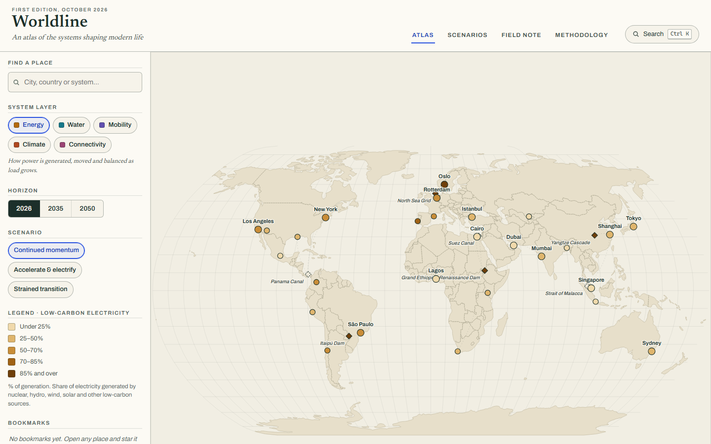
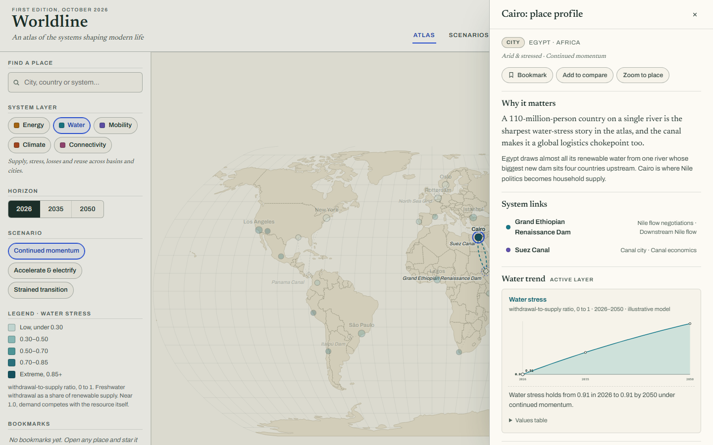
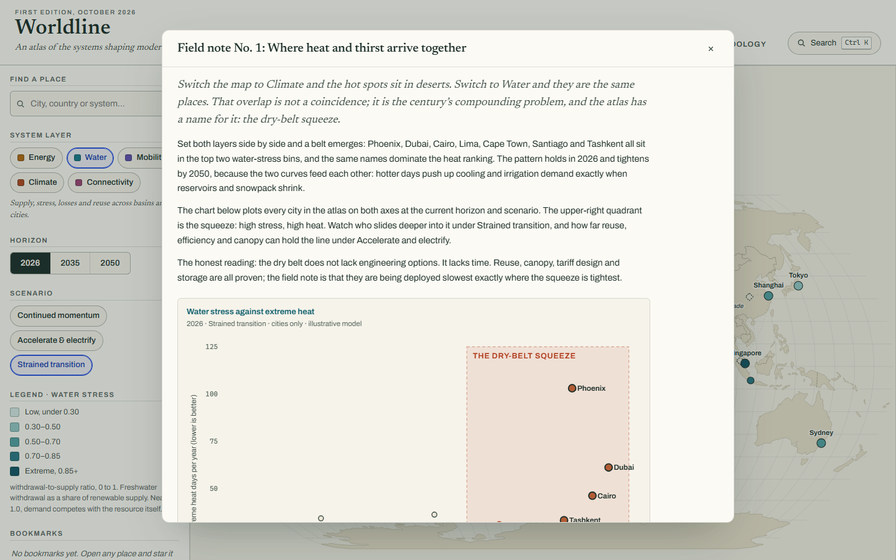

# Worldline

**An interactive, editorial-grade atlas of the systems shaping modern life: energy, water, mobility, climate resilience and digital connectivity.**

Worldline is a browser-based observatory: explore a world map, inspect places and the infrastructure linked to them, compare indicators across 2026 / 2035 / 2050, and read how three disclosed scenarios change the picture. It runs entirely client-side on bundled, deterministic, clearly-labelled illustrative data: no account, no API keys, no network calls at runtime.

**Live:** https://worldline-zeta.vercel.app

| Atlas | Place drawer | Field note |
| --- | --- | --- |
|  |  |  |


## Quick start

```bash
npm install        # dependencies (Node 20+ recommended)
npm run dev        # dev server at http://localhost:5173
npm run build      # typecheck + production build into dist/
npm run preview    # serve the production build at http://127.0.0.1:4173
```

The production build is a fully static site (any static host works; see [Deployment](#deployment)).

## What you can do

- **Explore.** A hand-built SVG world map (Natural Earth I projection) with five system layers, each with its own legend, units and colour ramp. Selecting a place highlights its connected infrastructure; links are drawn as arcs coloured by the system they belong to.
- **Inspect.** The place drawer gives every city or infrastructure node: why it matters, editorial context, its system links, a yearly trend chart for the active layer, all twenty indicators grouped by layer with deltas against the 2026 baseline, and risks/opportunities. Open it by mouse, touch, or keyboard (Tab into the map, Enter to open, Escape to close; focus returns to the place).
- **Compare.** Add any two places to the comparison. The panel pre-computes every gap (green chip = the B place is ahead), pairs the layer's headline metric as bars, and writes a plain-language interpretation. Layer, horizon and scenario are inherited from the atlas.
- **Scenarios.** Three scenarios (Continued momentum, Accelerate & electrify, Strained transition) share one model and differ only in disclosed assumptions. The scenario reader lists the assumptions in force and tabulates each place's deterministic change against the momentum baseline.
- **Field note.** One editorial piece ("Where heat and thirst arrive together") connects a map pattern to a scatter chart and a plain-language reading.
- **Command palette.** `Ctrl/⌘+K`: find places, switch layer/horizon/scenario, open views, reset. Full keyboard navigation.
- **Bookmarks, search, URL state.** Star places (persisted locally), search by city/country/system, and the atlas view, layer, horizon, scenario, selection and comparison all live in the URL, so refresh and back/forward restore state.

## Data honesty

All values are **illustrative modelled data**, labelled as such throughout the app:

- 2026 baselines are authored, rounded figures calibrated to feel plausible against publicly reported ranges. They are not official statistics and should not be cited.
- 2035/2050 values come from a deterministic model: each place follows an archetype trajectory toward a stated ceiling, at a speed the scenario adjusts. Same inputs, same outputs, on any machine, offline; the app has no randomness anywhere.
- Infrastructure nodes (grids, corridors, dams) carry only the indicators that mean something for that kind of asset; everything else is shown as "Not modelled", never interpolated.
- The in-app **Methodology** panel lists exactly what the model can and cannot claim. The scenario reader lists every assumption in force.
- Map geometry: [Natural Earth](https://www.naturalearthdata.com/) (public domain) via the [`world-atlas`](https://github.com/topojson/world-atlas) package (BSD-3). Simplified 1:110m geometry; de facto boundaries, no position on disputed territory. See `LICENSES.md`.

## Architecture

```
src/
  data/          typed domain layer, no React
    types.ts     LayerId, MetricId, Place, MetricDef, scenarios
    metrics.ts   the twenty indicator definitions (units, better-direction, explanations)
    layers.ts    five layers, identity hues, sequential ramps, legend bins
    model.ts     deterministic value engine: archetypes, curves, scenario scales
    places.ts    the gazetteer: 27 cities + 6 infrastructure nodes
    links.ts     place-to-infrastructure links (undirected)
    content.ts   methodology, field note, UI copy
  state/
    store.tsx    one reducer store: map, layer, horizon, scenario, drawer, compare, dialogs
    url.ts       URL encode/parse (validated) for view/layer/horizon/scenario/place/compare
    persist.ts   guarded localStorage (junk dropped, storage failure tolerated)
  geo/geo.ts     TopoJSON → GeoJSON, projection fitting, path strings
  components/    App shell, AtlasMap, Rail, PlaceDrawer, ComparePanel, ScenarioView,
                 FieldNote, Methodology, CommandPalette, Dialog, charts/TrendChart
  styles/        tokens.css (design tokens) · base.css · app.css · map.css
tests/           Vitest unit suites (data integrity, model determinism, reducer, URL, storage)
e2e/             Playwright: desktop journeys + mobile journeys
```

Design decisions worth knowing:

- **One shared state model.** Every view (map, drawer, compare, scenarios, palette) reads the same store, so a horizon or scenario change updates map, metrics, charts and interpretation together, by construction.
- **SVG, not WebGL.** The world map is a projection-fitted SVG with a pan/zoom transform group; screen-constant symbol sizes are compensated per zoom. No heavy map library, no WebGL requirement.
- **Charts are hand-rolled.** Axes, tick formatting, horizon markers and a visible values table (keyboard access to numbers without tooltips).
- **Two dialog modes.** Modal dialogs (palette, compare, readers) trap focus and lock scroll; the place drawer is deliberately non-modal so the layer/horizon controls stay live while a place is open. A dialog stack makes Escape peel overlays top-first.
- **Deltas are pre-computed and direction-aware.** Every metric declares whether up or down is better; chips, comparisons and interpretation copy never ask the reader to do arithmetic.

## Accessibility

Target: WCAG 2.2 AA. Landmarks and a skip link; every place on the map is a labelled, focusable button whose accessible name includes its current value; visible focus rings (cobalt) on map symbols and controls; focus is placed into drawers/dialogs on open and restored on close; `prefers-reduced-motion` removes transitions and map glides; charts carry visible units, titles, takeaways and data tables; colour encoding is always paired with legends, labels and text values; 360px-wide viewport tested for zero horizontal overflow; keyboard-only journeys are covered in e2e.

## Testing

```bash
npm run typecheck   # tsc --noEmit (strict)
npm run lint        # eslint
npm test            # Vitest unit suites (run once)
npm run e2e         # Playwright, desktop + mobile projects (builds must be served via its own webServer)
```

Unit suites verify data integrity (unique ids, coordinates, every city authors its headline metrics, links resolve, archetype rules cover their baselines), model determinism (2026 baselines unchanged, repeated calls identical, scenario ordering, bounds never exceeded), URL round-trips, reducer rules (compare rotation, bookmark toggling, reset) and storage failure fallbacks.

E2E (19 specs across desktop 1440px and mobile 390px projects) verify: load with zero console errors, layer → legend/map sync, horizon → map/drawer sync, keyboard-opened drawer with focus restore, compare add/swap/clear and empty tray, scenario determinism across reload, disclosed assumptions, search + empty state, bookmark persistence, URL refresh/back-forward restore, command palette, reset, storage-failure survival, missing-data states, reduced motion, mobile layout with zero overflow, bottom-sheet drawer, and touch controls.

`scripts/qa-shots.mjs` captures review screenshots at 360 / 390 / 768 / 1024 / 1440 px into `qa-shots/`.

## Performance

Desktop Lighthouse (production build, Oct 2026): **Performance 94, Accessibility 100, Best Practices 100, SEO 100** (SEO reached 100 once the social card shipped). The bundle is one JS chunk (~131 KB gzip including geography and self-hosted fonts); fonts are subset woff2 (Newsreader for display, Archivo for UI) served locally, no font CDN.

## Deployment

Any static host. For Vercel: framework preset **Vite**, build command `npm run build`, output directory `dist`. No environment variables, no server functions, no runtime services.

## Known limits

- The dataset is an editorial selection (33 places), not a census; regions are covered to make patterns legible, not exhaustive.
- Scenario outputs are illustrative by design; the methodology panel is the binding contract for what the numbers mean.
- The model is yearly and deterministic; it has no prices, politics, migration shocks or second-order effects.
- Water-stress values move slowly by design (stress is sticky); the dramatic model deltas live in energy, mobility and connectivity.
