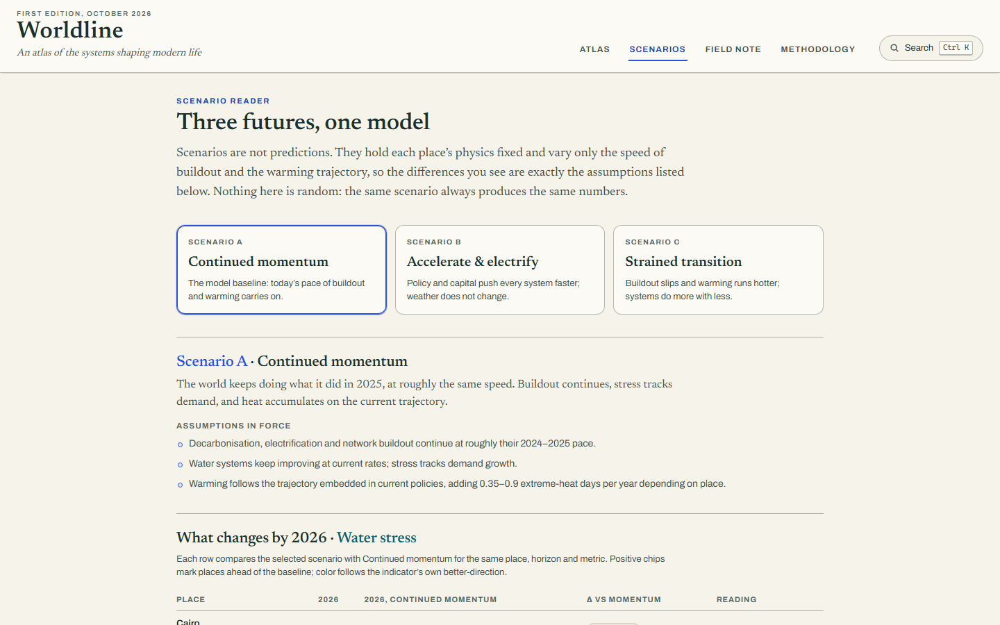
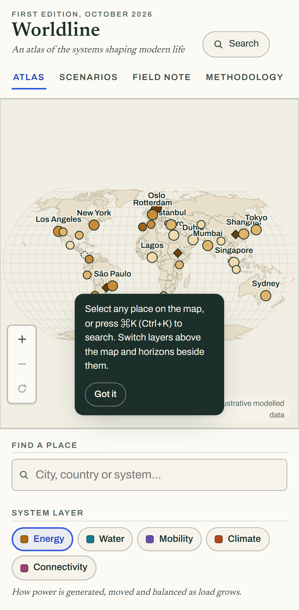

# Worldline

An interactive, editorial-grade atlas of the systems shaping modern life: energy, water, mobility, climate and connectivity, on one map.


## Live Demo

**https://worldline-zeta.vercel.app**

> Runs entirely in your browser on bundled, deterministic, clearly-labelled illustrative data. No account, no backend, no network calls. The 2026 values are authored editorial figures calibrated to public reference ranges; 2035 and 2050 are scenario outputs, not forecasts. The in-app methodology panel states exactly what the numbers can and cannot claim.

## Screenshots

| Atlas | Place drawer | Field note |
| --- | --- | --- |
|  |  |  |
| **Scenarios** | **Mobile** | |
|  |  | |

## Features

- **Explore** five system layers (Energy, Water, Mobility, Climate, Connectivity), each with its own legend, units and colour ramp, on a hand-built SVG Natural Earth map with pan, zoom and keyboard navigation.
- **Inspect** 33 places and infrastructure nodes: why it matters, editorial context, system links drawn as arcs, a yearly trend chart, all twenty indicators with deltas against 2026, and risks and opportunities. Opens by mouse, touch or keyboard, with focus returned on close.
- **Compare** any two places: every gap pre-computed with direction-aware chips, paired bars for the headline metric, and a plain-language interpretation. Layer, horizon and scenario carry over.
- **Read scenarios**: three futures sharing one deterministic model, differing only in disclosed assumptions. The scenario reader lists the assumptions in force and tabulates each place's change against the baseline.
- **Field note**: one editorial piece connecting a map pattern (the dry-belt squeeze) to a scatter chart and a plain reading.
- **Move fast**: command palette (Ctrl/⌘+K), bookmarks, search, light and dark themes, and full URL state, so refresh and back/forward restore the view.

## Stack

| Concern | Choice |
| --- | --- |
| Framework | React 18, strict TypeScript, Vite 7 |
| Map | d3-geo + world-atlas (Natural Earth, public domain), hand-rolled SVG |
| Charts | Hand-rolled SVG with axes, units, takeaways and data tables |
| State | One reducer store; URL sync; guarded localStorage |
| Tests | Vitest (39 unit) + Playwright (21 e2e, desktop and mobile) |
| Fonts | Newsreader + Archivo (OFL, self-hosted) |

## Quick start

```bash
npm install
npm run dev        # http://localhost:5173
npm run build      # typecheck + production build
npm run preview    # serve the production build
npm test           # unit suites
npm run e2e        # Playwright, desktop + mobile
```

## Data honesty

All values are illustrative modelled data, labelled as such throughout the app. The 2026 baselines are authored, rounded figures; later horizons follow published, deterministic rules under three scenarios. Infrastructure nodes carry only the indicators that mean something for that kind of asset; everything else reads "Not modelled", never interpolated. Map geometry comes from Natural Earth (public domain) via world-atlas (BSD-3). See `LICENSES.md` and the in-app methodology panel.

## Architecture

```
src/
  data/     typed domain layer: metrics, layers, places, deterministic model
  state/    one reducer store, URL encode/parse, guarded persistence
  geo/      TopoJSON to GeoJSON, projection fitting
  components/  map, rail, drawer, compare, scenarios, field note, palette
  styles/   design tokens (light and dark), editorial CSS
tests/      Vitest unit suites
e2e/        Playwright desktop and mobile journeys
```

## Accessibility

WCAG 2.2 AA is the working target: landmarks and a skip link, every map place is a labelled focusable button carrying its current value, visible cobalt focus rings, focus moved into and restored from dialogs, `prefers-reduced-motion` honoured, charts carry visible units and data tables, and 360px viewports run with zero horizontal overflow.

## Known limits

- The dataset is an editorial selection of 33 places, not a census.
- Scenario outputs are illustrative by design; the methodology panel is the binding contract.
- The model has no prices, politics, migration shocks or second-order effects.
- Water stress moves slowly by design; the larger model deltas live in energy, mobility and connectivity.

## Deployment

Any static host. On Vercel: framework preset Vite, build command `npm run build`, output directory `dist`. No environment variables, no server functions.

## License

[MIT](LICENSE)
